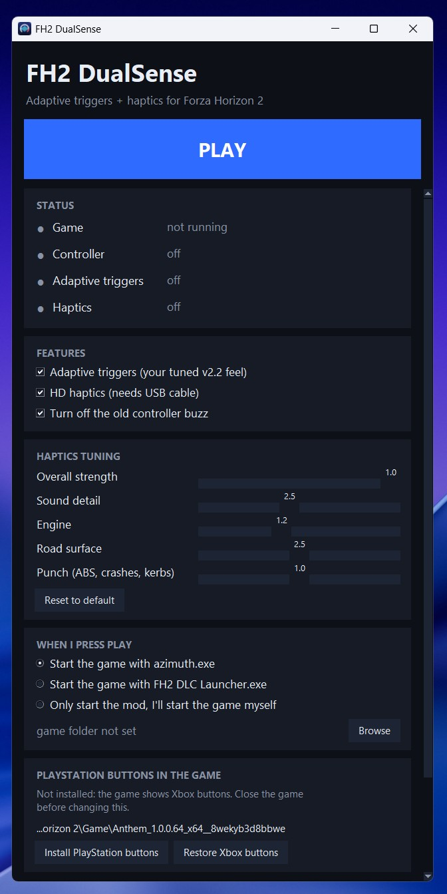

# FH2 DualSense

Adaptive triggers and HD haptics on a PlayStation DualSense controller for Forza Horizon 2 running through Azimuth.

* **Adaptive triggers:** the game's own trigger rumble levels are read from Azimuth and sent to the DualSense triggers.
* **HD haptics:** the car's engine, road, skid, impact and shift sounds are captured from the game's audio engine and played through the DualSense haptic actuators.
* **Small control window:** turn each feature on or off, tune haptics strength, and launch the game from the same window.
  
   
  
## Requirements

* Windows with Python 3 (python.org, tick "Add python.exe to PATH").
* A DualSense controller connected by **USB cable** (haptics need USB).
* An xinput emulator so the dualsense work with the game (steam input or DS4win or DSX ... )
* Azimuth and your own copy of Forza Horizon 2, game build 1.0.0.64. Other builds are not supported, and the mod will say so in its log instead of hooking.
* In Windows Sound settings: Speakers (DualSense Wireless Controller) > Configure > Quadraphonic, volume 100.

## Install and run

1. Download the repository (Code > Download ZIP) and extract it anywhere.
2. Double-click `FH2 DualSense.bat`. It asks for administrator rights, and the first run installs the Python packages `hidapi`, `sounddevice`, `numpy` and `scipy`.
3. Press **Browse** once and pick `azimuth.exe` (or `FH2 DLC Launcher.exe`).
4. Press **PLAY**. The game starts, then triggers and haptics switch on by themselves. The status dots turn green when each part is live.
5. Press **STOP** or close the window to reset the triggers and bring the normal rumble back.

The first run also creates an `FH2 DualSense` shortcut next to the batch file. Use that from then on.

## Why it asks for administrator rights

The mod reads a small amount of memory from `azimuth.exe` (the trigger rumble values) and loads a small DLL into it (to listen to the game's car sounds). Windows requires elevation for that. Nothing is written to disk by the memory hook, and it disappears when the game closes. Read the code in `app/azimuth_hook.py` and `source/fh2_fmodtap.c` if you want to check.

Because the mod works this way, some antivirus programs may flag `fh2_fmodtap2.dll` or the launcher. If you would rather not trust the prebuilt DLL, build it yourself from `source/fh2_fmodtap.c` (see below).

## Files

* `app/` the programs: the control window, trigger and haptics scripts, the Azimuth hook, and the prebuilt `fh2_fmodtap2.dll`. `settings.json` is created here from your menu choices.
* `source/` source of the sound tap DLL.

## Building the DLL yourself

`source/fh2_fmodtap.c` only includes standard Windows headers. Build it as a 64 bit DLL with an x64 C compiler and save the result as `app/fh2_fmodtap2.dll`. For example with MinGW-w64:

```
x86_64-w64-mingw32-gcc -shared -O2 -o fh2_fmodtap2.dll source/fh2_fmodtap.c
```

This command is a starting point, so adjust flags for your toolchain if it complains.

## Troubleshooting

* A log named `fmodtap_log.txt` is written next to the DLL when the sound tap loads. It says whether the game build matched.
* No haptics: check the Quadraphonic setting, USB connection and the volume of the DualSense speaker device.
* If the controller does nothing after a crash, press STOP or close and reopen the window to reset the triggers.

## Disclaimer

This project is not affiliated with or endorsed by Microsoft, Playground Games, Sony or the Azimuth developers. It contains no game files and no Azimuth files. You need your own legitimate copy of the game and Azimuth. Use it at your own risk.

## License

MIT, see `LICENSE`.
